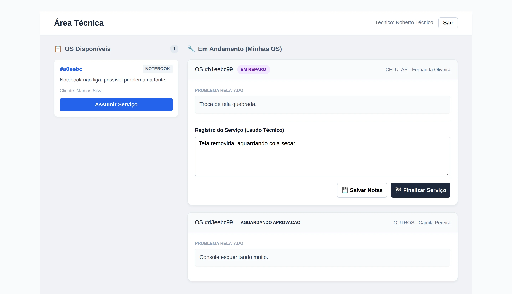
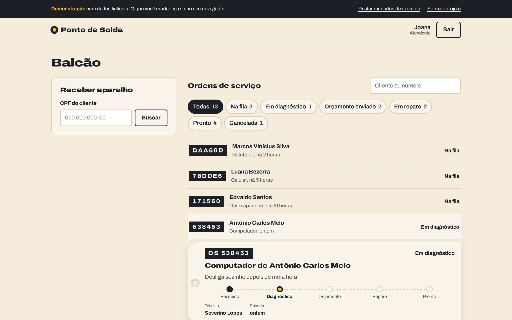
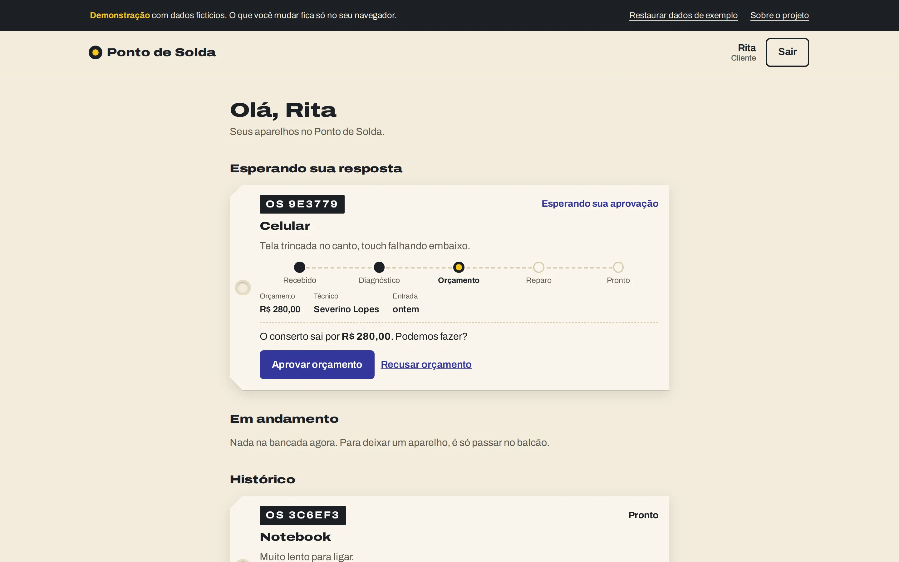
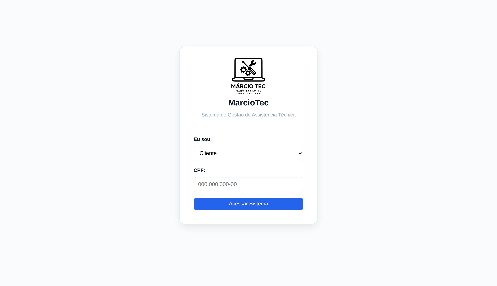

# Sistema de Assistência Técnica

Este é um sistema completo para gerenciamento de uma assistência técnica de equipamentos eletrônicos. O projeto opera com uma arquitetura **Full Stack**, utilizando uma API REST em **Java (Spring Boot)** no back-end e uma interface moderna em **Vue.js** no front-end.

O sistema gerencia todo o ciclo de vida de uma Ordem de Serviço (OS), desde o cadastro do cliente e abertura do chamado até o diagnóstico técnico, orçamento, reparo e entrega.

## 🚀 Funcionalidades Principais

O sistema atende a quatro perfis de usuários, conforme mapeado nos Casos de Uso:

* **Atendente**:
    * Cadastrar Clientes (validação de CPF e idade).
    * Abrir novas Ordens de Serviço (selecionando Cliente e Tipo de Hardware).
    * Consultar status de OS.
* **Técnico**:
    * Visualizar fila de OS abertas.
    * **Assumir OS** (auto-atribuição de responsabilidade).
    * Realizar Orçamento (com valor e descrição técnica).
    * Executar Reparo (seguindo roteiro padronizado por tipo de equipamento).
    * Finalizar OS.
* **Cliente**:
    * Visualizar histórico de equipamentos.
    * Aprovar ou Recusar orçamentos pendentes.
    * Cancelar solicitações.
* **Administrador**:
    * Gestão de relatórios (Financeiro, Estoque, OS).
    * Exclusão de registros (permissão elevada).

## 🖼️ Telas

| Área técnica | Painel de atendimento |
| :---: | :---: |
|  |  |
| **Área do cliente** | **Acesso** |
|  |  |

Estudo de caso completo em [marciodev.com/projetos/assistencia-tecnica](https://marciodev.com/projetos/assistencia-tecnica).

## 🏛️ Arquitetura e Padrões de Projeto

O back-end foi construído com foco em código limpo e extensível, utilizando padrões de projeto clássicos (GoF):

### 1. Padrão State (Máquina de Estados)
Gerencia o fluxo de vida da OS, impedindo transições inválidas (ex: não é possível finalizar uma OS que não foi aprovada).
* **Interface**: `StateInterface`
* **Estados Implementados**:
    * `ABERTA`: Estado inicial.
    * `AGUARDANDO_ORCAMENTO`: Quando o técnico assume e está analisando.
    * `AGUARDANDO_APROVACAO`: Orçamento enviado, aguardando cliente.
    * `EM_REPARO`: Aprovado, execução técnica em andamento.
    * `FINALIZADA`: Concluída com sucesso.
    * `CANCELADA`: Interrompida pelo cliente ou técnico.

### 2. Padrão Template Method (Roteiro de Reparo)
Padroniza o algoritmo de execução do serviço, garantindo que passos obrigatórios (Diagnóstico, Testes) sejam cumpridos, permitindo variações apenas na execução específica.
* **Classe Abstrata**: `TemplateMethod` (método `executarProcessoReparo` é final).
* **Implementações Concretas**:
    * `ReparoNotebook`: Foca em diagnóstico de HD/SSD, Memória e Tela.
    * `ReparoCelular`: Foca em bateria e tela touch.
    * `ReparoComputador`: Foca em fonte (PSU) e pasta térmica.
    * `ReparoOutros`: Implementação genérica.

### 3. Padrão Singleton
Utilizado na classe `DatabaseConnector` para garantir uma instância única de conexão direta (embora o Spring Data JPA gerencie suas próprias conexões, este padrão foi implementado para fins didáticos/arquiteturais no pacote `service.config`).

## 🛠️ Tecnologias Utilizadas

### Back-end
* **Java 21**
* **Spring Boot 3.5.7**
* **Spring Data JPA** (Hibernate)
* **PostgreSQL** (Banco de Produção) / **H2 Database** (Banco em Memória para testes)
* **Maven** (Build Tool)

### Front-end
* **Vue.js 3** (Composition API)
* **Vite** (Build Tool rápida)
* **Vue Router** (Navegação SPA)
* **Axios** (Comunicação HTTP)
* **CSS Puro** (Estilização customizada com variáveis CSS)

## 🚀 Como Executar

### Pré-requisitos
* Java JDK 21+
* Node.js 18+
* PostgreSQL (Opcional, se configurado H2)

### Passo 1: Subir o Back-end
1.  Navegue até a pasta do servidor:
    ```bash
    cd assistencia_tecnica
    ```
2.  Configure o banco de dados no arquivo `src/main/resources/application.properties` (se for usar PostgreSQL).
3.  Execute a aplicação:
    ```bash
    ./mvnw spring-boot:run
    ```
    *O servidor iniciará na porta `8080`.*

### Passo 2: Subir o Front-end
1.  Em um novo terminal, navegue até a pasta do cliente:
    ```bash
    cd frontend-assistencia
    ```
2.  Instale as dependências:
    ```bash
    npm install
    ```
3.  Gere o build de produção e inicie em modo de visualização (Preview):
    ```bash
    npm run build
    npm run preview
    ```
    *O front-end estará disponível em `http://localhost:4173` (porta padrão do preview).*

## 📚 Documentação da API

A API REST segue os seguintes endpoints principais:

* `POST /api/clientes` - Cadastra novo cliente.
* `POST /api/os` - Abre nova Ordem de Serviço.
* `PUT /api/os/{id}` - Atualiza dados da OS (usado para assumir OS).
* `POST /api/os/{id}/orcamentar` - Registra orçamento.
* `POST /api/os/{id}/aprovar` - Cliente aprova orçamento.
* `POST /api/os/{id}/executar` - Técnico executa o Template Method.